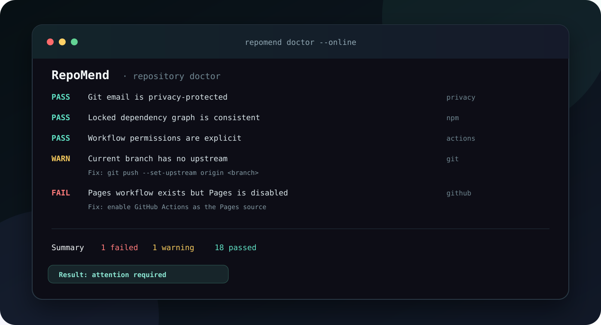

<div align="center">
  

  # RepoMend

  **Find out why a repository is unsafe, unshippable, or failing before the next push.**

  [](https://github.com/RepoEnjoyer/RepoMend/actions/workflows/ci.yml)
  [](LICENSE)
  [](package.json)
</div>

RepoMend is a deterministic, privacy-safe repository doctor. It checks Git state, author privacy, tracked files, dependency health, GitHub Actions, README integrity, community files, Pages configuration, and the current GitHub Actions result—then explains the next useful action.

It does not require an AI model, send source files to a service, hide findings behind a score, or change anything during `doctor`.

## Why RepoMend

Repository failures rarely begin with one obvious error. A branch has no upstream, a dependency bot updates an unsupported major version, CI uses different Node versions, Pages is never enabled, or a real email is embedded in commit history. RepoMend collects these problems into one redacted report that works locally and in CI.

## Features

- **Git diagnosis:** detached HEAD, missing origin, embedded remote credentials, missing upstream, branch divergence, and dirty worktrees.
- **Privacy checks:** effective Git identity and recent author history are evaluated without printing names or email addresses.
- **File hygiene:** tracked environment files, generated directories, large files, external symlinks, and case-only collisions.
- **Dependency checks:** lockfile selection, expected quality scripts, declared Node support, install hooks, and npm peer/lock consistency without executing lifecycle scripts.
- **Workflow review:** explicit permissions, `write-all`, remote shell pipelines, mutable action references, unsafe event interpolation, inherited secrets, and `pull_request_target` warnings.
- **Documentation verification:** broken relative links, personal filesystem paths, placeholders, visuals, and missing operational sections.
- **Community health:** licence, security policy, contribution guide, changelog, conduct policy, templates, and Dependabot.
- **Optional GitHub checks:** public metadata, topics, recognised licence, Pages state, and Actions results for local `HEAD`.
- **Useful reports:** readable terminal output plus stable JSON and Markdown formats.
- **Explicit fixes:** dry-run by default; current safe fixes protect local files and configure a repository-local noreply identity.

## Installation

RepoMend requires Node.js 20.12 or newer.

### Install the release

```bash
npm install --global https://github.com/RepoEnjoyer/RepoMend/releases/download/v1.0.0/repomend-1.0.0.tgz
repomend --version
```

### Build from source

```bash
git clone https://github.com/RepoEnjoyer/RepoMend.git
cd RepoMend
npm ci
npm run build
npm link
```

No runtime dependencies are installed with the CLI. Development dependencies are locked in `package-lock.json`.

## Quick start

Run local checks from a repository:

```bash
repomend doctor
```

Include opt-in public GitHub metadata and current Actions state:

```bash
repomend doctor --online
```

Create a machine-readable report:

```bash
repomend doctor --format json --output repomend-report.json
repomend doctor --format markdown --output repomend-report.md
```

Treat warnings as unsuccessful in CI:

```bash
repomend doctor --strict
```

## Safe fixes

`fix` is always a preview unless `--apply` is present:

```bash
repomend fix --github-user RepoEnjoyer
repomend fix --github-user RepoEnjoyer --apply
```

The applied form:

1. Adds missing privacy and local-build entries to `.gitignore` without replacing existing rules.
2. Configures `user.name`, a GitHub noreply email, and `user.useConfigOnly` in this repository only.

RepoMend never rewrites Git history, removes files, pushes branches, changes GitHub settings, or rotates credentials automatically.

## Exit codes

| Code | Meaning |
| --- | --- |
| `0` | No failing findings; warnings are allowed unless `--strict` is used. |
| `1` | The report contains failures, or warnings under strict mode. |
| `2` | Invalid arguments, configuration, or an operational error. |

## Configuration

Create `.repomend.json`:

```bash
repomend init
```

Example:

```json
{
  "version": 1,
  "ignore": ["community.code-of-conduct"],
  "failOnWarnings": false
}
```

Only exact finding identifiers are ignored. See [configuration](docs/configuration.md) and the [check catalogue](docs/checks.md).

## Privacy and security

Local checks do not make network requests. `--online` sends only the repository slug and current commit SHA to GitHub's API; it does not upload files or command output. A `GITHUB_TOKEN` is optional for private repositories or higher rate limits and is never included in a report.

RepoMend redacts:

- email addresses;
- credential-bearing URLs;
- common GitHub and cloud token formats;
- home-directory paths;
- external symlink targets;
- unsafe tracked filenames.

Redaction reduces accidental disclosure but is not a complete secret scanner. Use a dedicated secret-scanning tool before publication. Report vulnerabilities through [SECURITY.md](SECURITY.md).

## CI usage

After installing RepoMend in your workflow:

```yaml
- name: Audit repository readiness
  run: repomend doctor --strict --format markdown --output repomend-report.md
```

Online checks are intentionally omitted from the default CI example so forks do not require tokens or network access.

## Troubleshooting

- **`npm dependency check skipped`:** install npm or use the package manager-specific findings that remain available.
- **`No upstream branch`:** run `git push --set-upstream origin <branch>` on the first push.
- **Online status `403`:** GitHub's unauthenticated API rate limit was likely reached; retry later or provide a read-only token.
- **Identity still fails after fixing:** existing commits retain their original author metadata. RepoMend does not rewrite shared history.
- **Unexpected warning:** use the finding identifier in `.repomend.json` only after documenting why it is acceptable.

See the full [troubleshooting guide](docs/troubleshooting.md).

## Limitations

- RepoMend diagnoses GitHub repository settings but cannot enable Pages or branch protection for you.
- Workflow analysis is intentionally conservative and does not replace GitHub CodeQL, actionlint, or a security review.
- npm receives the deepest dependency check in v1; pnpm, Yarn, and Bun currently receive lockfile-level checks.
- README checks validate local targets and structure, not the truth of every written claim.
- Git divergence reflects the last local fetch; RepoMend never fetches automatically.

## Development

```bash
npm ci
npm run check
npm pack --dry-run
```

The project uses TypeScript, Node's process APIs, Vitest, and ESLint. There are no runtime packages. Read [CONTRIBUTING.md](CONTRIBUTING.md) and [AI_HANDOFF.md](AI_HANDOFF.md) before larger changes.

## Roadmap

- pnpm, Yarn, Bun, Python, Rust, and Go dependency adapters.
- A signed standalone executable for Windows, macOS, and Linux.
- GitHub branch-protection and ruleset checks with fine-grained read-only authentication.
- Sandboxed installation and README command verification.
- SARIF output and first-party GitHub Action packaging.
- A plugin API for specialised checks without expanding the trusted core.

See [ROADMAP.md](ROADMAP.md) for sequencing and acceptance criteria.

## Licence

MIT © RepoEnjoyer. See [LICENSE](LICENSE).
